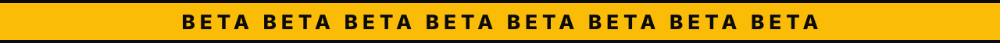
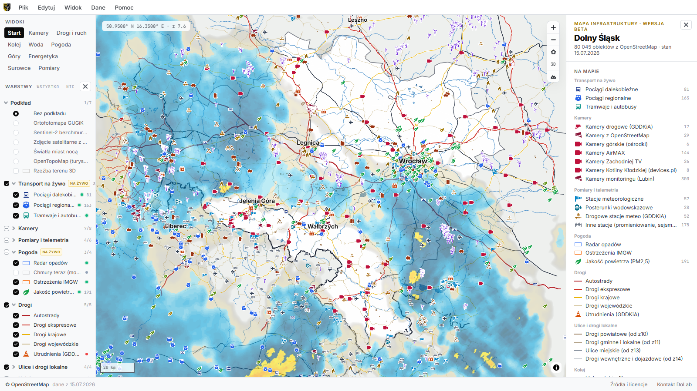

<p align="center">
  
</p>

<p align="center">
  
</p>

<h1 align="center">Mapa infrastruktury Dolnego Śląska <sup>beta</sup></h1>

<p align="center">
  Drogi, kolej, woda, energetyka, przemysł, kamery i dane na żywo w jednym pliku HTML.<br>
  Działa po dwukliku, bez serwera i bez instalacji. Projekt <a href="https://www.dolnyslask.tech">DoLab</a>,
  autor: <a href="https://www.linkedin.com/in/patzag/">Patryk Zagórski</a>.
</p>

<p align="center">
  
  
  
  
</p>

<p align="center">
  <a href="https://dolnyslask-tech.github.io/dolab-infra-prod/"><b>Otwórz mapę w przeglądarce</b></a>
</p>

> [!WARNING]
> **To jest wersja beta.** Mapa działa, ale wciąż ją rozwijamy: dane mogą
> mieć luki, część warstw i opisów się zmieni, a położenie niektórych
> obiektów jest przybliżone (mówi o tym panel obiektu). Nie opieraj na niej
> decyzji, w których błąd ma znaczenie. Znalazłeś błąd albo masz pomysł?
> [Napisz do nas](https://www.dolnyslask.tech/kontakt).

[](https://dolnyslask-tech.github.io/dolab-infra-prod/)

## Co to jest

Interaktywna mapa infrastruktury województwa dolnośląskiego i 30-kilometrowego
pasa w Czechach i Niemczech: **85 059 obiektów** z OpenStreetMap
w 18 warstwach, **530 kamer** i kilkanaście źródeł danych na żywo.

- **Infrastruktura:** drogi i ulice, kolej, mosty i przeprawy, przejścia
  graniczne, lotniska, logistyka, energetyka, kopalnie, przemysł, wody, szczyty.
- **Na żywo:** pociągi i autobusy, radar opadów, wodowskazy i ostrzeżenia
  IMGW, utrudnienia na drogach, jakość powietrza, zachmurzenie, satelity.
- **Podkłady:** ortofotomapa, Sentinel-2, zdjęcie satelitarne z wczoraj,
  światła miast nocą, mapa turystyczna, rzeźba terenu 3D.

Mapa pokazuje stan, nie wystawia ocen: nie ma tu rankingów ani wskaźników.

## Uruchom

Potrzebny jest tylko Python 3.9 lub nowszy, bez dodatkowych pakietów i kluczy.

```bash
git clone https://github.com/dolnyslask-tech/dolab-infra-prod.git
cd dolab-infra-prod
python zbuduj.py
```

Powstaje plik `infra-podglad.html`. Otwórz go dwuklikiem. Dane stałe są
w środku, więc mapa działa też bez internetu; warstwy na żywo dociągają się,
gdy jest sieć.

## Jak to działa

```
├── app/        aplikacja: index.html, app.css, src/00..09-*.js
├── assets/     MapLibre GL, satellite.js, czcionki, kontury krajów
├── data/       warstwy GeoJSON przygotowane z OpenStreetMap
└── zbuduj.py   skleja wszystko w jeden plik infra-podglad.html
```

Wszystko, co zwykle ładuje się z sieci, leży w `assets/` i trafia do pliku
przy budowie. Aplikacja nie ma serwera: dane na żywo przeglądarka pobiera
wprost od dostawców. Warstwy w `data/` przygotowuje DoLab z OpenStreetMap
i odświeża przy kolejnych wydaniach.

## Dane i licencje

- **Kod:** [MIT](LICENSE).
- **Dane z OpenStreetMap:** © współtwórcy OpenStreetMap,
  [ODbL](https://opendatacommons.org/licenses/odbl/).
- **Pozostałe źródła, składniki i opis pól danych:** [DANE.md](DANE.md).
- **Kamery:** mapa pokazuje punkt i link do podglądu u operatora, nie obraz.

## O DoLab

**Dolnośląskie Laboratorium Nowych Technologii** to niezależny technologiczny
think tank i organizacja non-profit z Wrocławia. Łączymy technologie, dane
i ludzi, żeby tworzyć realną wartość dla regionu: otwarte dane, narzędzia,
analizy i edukację.

[dolnyslask.tech](https://www.dolnyslask.tech) ·
[kontakt](https://www.dolnyslask.tech/kontakt)

## Autor

<table>
  <tr>
    <td>
      <b>Patryk Zagórski</b><br><br>
      <a href="https://www.linkedin.com/in/patzag/"></a><br>
      E-mail: <a href="mailto:patryk.zagorski@dolnyslask.tech">patryk.zagorski@dolnyslask.tech</a>
    </td>
  </tr>
</table>
